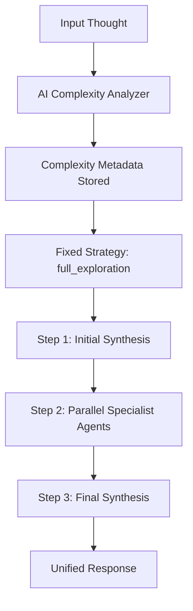

# Sequential Thinking Multi-Agent System (MAS) 

[](https://www.python.org/downloads/) [](https://github.com/agno-agi/agno) [](https://x.com/FradSer)

**English** | [简体中文](README.zh-CN.md)

An MCP server that processes sequential thoughts through a team of specialized AI agents, each analyzing the problem from a different cognitive perspective.

## What This Is

This is an **MCP server**, not a standalone application. It runs as a background service that extends an MCP-compatible LLM client (like Claude Desktop) with structured sequential-thinking capabilities. It exposes one tool, `sequentialthinking`, that runs every thought through a fixed multi-agent workflow: an initial synthesis, several specialist agents thinking in parallel, and a final synthesis that answers the original question.

## How It Works

The system uses a fixed `full_exploration` strategy for every request. The AI complexity analyzer still runs to record diagnostic metadata (complexity score, problem type, required thinking modes), but it no longer changes the execution path — all thoughts take the same route:



### The Specialist Agents

Each request runs six specialist agents in parallel, plus a synthesis agent that runs twice (once at the start, once at the end). Every specialist except synthesis can optionally use web research via ExaTools.

| Agent | Thinking direction | Focus | Time budget |
| --- | --- | --- | --- |
| Factual | `factual` | Objective facts and verified data | 120s |
| Emotional | `emotional` | Intuition and gut reactions | 30s |
| Critical | `critical` | Risks, weaknesses, logical flaws | 120s |
| Optimistic | `optimistic` | Benefits, opportunities, value | 120s |
| Creative | `creative` | New ideas and alternatives | 240s |
| Meta-cognitive | `metacognitive` | Bias detection and reasoning-process evaluation | 90s |
| Synthesis | `synthesis` | Integration and final answer | 60s |

Key properties:

- **Deterministic**: every request runs the same multi-step path.
- **Parallel**: the specialist agents run simultaneously with `asyncio.gather`.
- **Synthesis-driven**: both orchestration and the final answer come from the synthesis agent, which uses the enhanced model.

### Model Strategy

Two models are configured per provider:

- **Enhanced model**: used by the synthesis agent (integration tasks).
- **Standard model**: used by the specialist agents.

### Research Capabilities

ExaTools is attached to every agent except synthesis. Research is **optional** — it activates only when `EXA_API_KEY` is set. Without it, the system works on pure reasoning.

## The `sequentialthinking` Tool

The server exposes one MCP tool.

### Input

```typescript
{
  thought: string,               // One focused reasoning step
  thoughtNumber: number,         // 1-based step index; increment each call
  totalThoughts: number,         // Planned number of steps
  nextThoughtNeeded: boolean,    // true for intermediate steps, false on final step
  isRevision: boolean,           // true only when revising earlier conclusions
  branchFromThought?: number,    // Set with branchId to branch from a prior step
  branchId?: string,             // Branch identifier (required when branching)
  needsMoreThoughts: boolean     // true only when extending beyond totalThoughts
}
```

### Output

```typescript
{
  should_continue: boolean,      // Canonical continuation signal
  next_thought_number: number?,  // Recommended next thoughtNumber
  stop_reason: string,           // Why to continue/stop/retry
  current_thought_number: number,
  total_thoughts: number,
  next_call_arguments?: {        // Suggested next-call arguments when applicable
    thoughtNumber: number,
    totalThoughts: number,
    nextThoughtNeeded: boolean,
    needsMoreThoughts: boolean
  },
  parameter_usage: Record<string, string>
}
```

### Call Contract

- Treat this tool as a **multi-step loop**, not a one-shot call.
- After every response, read `structuredContent.should_continue`.
- Keep calling until `should_continue` is `false`.
- Actively use reflection: when a step is weak or incorrect, send a revision step with `isRevision=true`.
- Prefer `structuredContent.next_thought_number` and `next_call_arguments` when building the next request.

## Supported Providers

| Provider | Env var | Default enhanced model | Default standard model |
| --- | --- | --- | --- |
| DeepSeek (default) | `DEEPSEEK_API_KEY` | `deepseek-chat` | `deepseek-chat` |
| Groq | `GROQ_API_KEY` | `openai/gpt-oss-120b` | `openai/gpt-oss-20b` |
| OpenRouter | `OPENROUTER_API_KEY` | `deepseek/deepseek-chat-v3-0324` | `deepseek/deepseek-r1` |
| GitHub Models | `GITHUB_TOKEN` | `openai/gpt-5` | `openai/gpt-5-min` |
| Anthropic | `ANTHROPIC_API_KEY` | `claude-3-5-sonnet-20241022` | `claude-3-5-haiku-20241022` |
| Ollama | none | `devstral:24b` | `devstral:24b` |

## Installation

### Prerequisites

- Python 3.10+
- An LLM API key from one of the providers above
- Optional: `EXA_API_KEY` for web research
- `uv` package manager (recommended) or `pip`

### Install

```bash
git clone https://github.com/FradSer/mcp-server-mas-sequential-thinking.git
cd mcp-server-mas-sequential-thinking

uv pip install .        # or: pip install .
```

### Configure an MCP Client

Add to your MCP client configuration:

```json
{
  "mcpServers": {
    "sequential-thinking": {
      "command": "mcp-server-mas-sequential-thinking",
      "env": {
        "LLM_PROVIDER": "deepseek",
        "DEEPSEEK_API_KEY": "your_api_key",
        "EXA_API_KEY": "your_exa_key_optional"
      }
    }
  }
}
```

### Environment Variables

```bash
# LLM provider (required)
LLM_PROVIDER="deepseek"  # deepseek, groq, openrouter, github, anthropic, ollama
DEEPSEEK_API_KEY="sk-..."

# Optional: override the models per provider (prefixed by provider name)
# DEEPSEEK_ENHANCED_MODEL_ID="deepseek-chat"
# DEEPSEEK_STANDARD_MODEL_ID="deepseek-chat"

# Optional: web research (enables ExaTools)
# EXA_API_KEY="your_exa_api_key"

# Optional: custom endpoint
# LLM_BASE_URL="https://custom-endpoint.com"

# Optional: team orchestration mode (standard/broadcast, route, coordinate)
# TEAM_MODE="standard"
```

### Run the Server Directly

```bash
mcp-server-mas-sequential-thinking        # installed script
uv run mcp-server-mas-sequential-thinking  # or via uv
```

## Development

```bash
# Install with dev dependencies
uv pip install -e ".[dev]"

# Code quality
uv run ruff check . --fix
uv run ruff format .
uv run mypy .

# Run tests
uv run pytest tests/

# Or use the Makefile
make test        # all tests with coverage + quality checks
make test-fast   # fast run without coverage
make check-all   # all quality checks
```

### Test with MCP Inspector

```bash
npx @modelcontextprotocol/inspector uv run mcp-server-mas-sequential-thinking
```

Open http://127.0.0.1:6274/ and test the `sequentialthinking` tool.

## Token Consumption Warning

The multi-agent architecture consumes significantly more tokens than a single-agent tool — roughly 5-10x more per `sequentialthinking` call, because every call invokes multiple specialist agents. The tradeoff is deeper, multi-perspective analysis.

## Project Structure

```
mcp-server-mas-sequential-thinking/
├── src/mcp_server_mas_sequential_thinking/
│   ├── main.py                          # MCP server entry point (MCPServer)
│   ├── processors/
│   │   ├── multi_thinking_core.py       # Specialist agent definitions
│   │   └── multi_thinking_processor.py  # Parallel sequence execution
│   ├── routing/
│   │   ├── ai_complexity_analyzer.py    # AI complexity analysis
│   │   ├── complexity_types.py          # Complexity metric models
│   │   └── multi_thinking_router.py     # Fixed full_exploration routing
│   ├── services/
│   │   ├── server_core.py               # ThoughtProcessor implementation
│   │   ├── processing_orchestrator.py   # Agno Team orchestration
│   │   ├── workflow_executor.py
│   │   └── context_builder.py
│   ├── infrastructure/
│   │   ├── persistent_memory.py         # SQLite session storage
│   │   └── learning_resources.py        # Agent learning machine
│   ├── security/rate_limiter.py         # Rate limiting and request validation
│   └── config/
│       ├── modernized_config.py         # Provider strategies
│       └── constants.py                 # System constants
├── scripts/mcp_python_client_smoke.py   # Protocol smoke test
├── tests/                               # Unit and integration tests
├── pyproject.toml
└── Makefile
```

## Changelog

See [CHANGELOG.md](CHANGELOG.md) for version history.

## Contributing

Contributions are welcome. Please ensure:

1. Code follows the project style (ruff, mypy)
2. Commit messages use conventional commits format
3. All tests pass before submitting a PR
4. Documentation is updated as needed

## License

This project does not yet declare a license. See the [LICENSE discussion](https://github.com/FradSer/mcp-server-mas-sequential-thinking/issues) if you need to reuse it.

## Acknowledgments

- Built with [Agno](https://github.com/agno-agi/agno) v2.x
- Model Context Protocol by [Anthropic](https://www.anthropic.com/)
- Research capabilities powered by [Exa](https://exa.ai/) (optional)
- Multi-dimensional thinking inspired by Edward de Bono's work

## Support

- GitHub Issues: [Report bugs or request features](https://github.com/FradSer/mcp-server-mas-sequential-thinking/issues)
- Documentation: see CLAUDE.md for implementation notes
- MCP Protocol: [Official MCP Documentation](https://modelcontextprotocol.io/)
