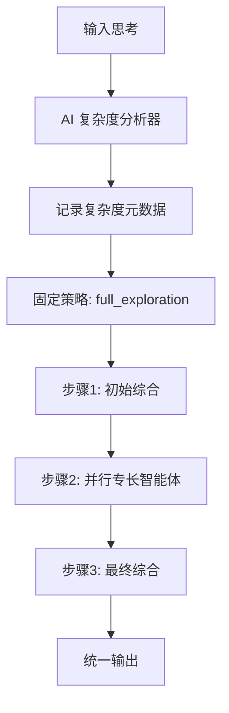

# 序列思考多智能体系统 (MAS) 

[](https://www.python.org/downloads/) [](https://github.com/agno-agi/agno) [](https://x.com/FradSer)

[English](README.md) | **简体中文**

一个 MCP 服务器，通过一组专职 AI 智能体处理序列思考，每个智能体从不同的认知角度分析问题。

## 这是什么

这是一个 **MCP 服务器**，不是独立应用程序。它以后台服务方式运行，为 MCP 兼容的 LLM 客户端（如 Claude Desktop）扩展结构化的序列思考能力。它暴露一个 `sequentialthinking` 工具，将每个思考都跑一遍固定的多智能体流程：先做一次初始综合，再由多个专长智能体并行思考，最后做一次综合来回答原始问题。

## 工作原理

系统对每个请求都使用固定的 `full_exploration` 策略。AI 复杂度分析器仍然运行以记录诊断元数据（复杂度评分、问题类型、所需思维模式），但它不再改变执行路径——所有思考都走同一条路线：



### 专长智能体

每个请求并行运行六个专长智能体，外加一个综合智能体（在开头和结尾各运行一次）。除综合外的每个专长智能体都可以通过 ExaTools 选择性地使用网络研究。

| 智能体 | 思考方向 | 关注点 | 时间预算 |
| --- | --- | --- | --- |
| 事实 | `factual` | 客观事实和已验证数据 | 120 秒 |
| 情感 | `emotional` | 直觉和本能反应 | 30 秒 |
| 批判 | `critical` | 风险、弱点、逻辑缺陷 | 120 秒 |
| 乐观 | `optimistic` | 利益、机会、价值 | 120 秒 |
| 创意 | `creative` | 新想法和替代方案 | 240 秒 |
| 元认知 | `metacognitive` | 偏见检测与推理过程评估 | 90 秒 |
| 综合 | `synthesis` | 整合与最终答案 | 60 秒 |

关键特性：

- **确定性**：每个请求都执行同一条多步骤路径。
- **并行**：专长智能体通过 `asyncio.gather` 同时运行。
- **综合驱动**：编排与最终答案都由综合智能体完成，它使用增强模型。

### 模型策略

每个提供商配置两个模型：

- **增强模型**：用于综合智能体（整合任务）。
- **标准模型**：用于专长智能体。

### 研究能力

ExaTools 挂载在除综合外的每个智能体上。研究是**可选的**——只有设置了 `EXA_API_KEY` 才启用。没有它，系统仅靠纯推理也能正常工作。

## `sequentialthinking` 工具

服务器只暴露这一个 MCP 工具。

### 输入

```typescript
{
  thought: string,               // 单个聚焦的思考步骤
  thoughtNumber: number,         // 1 起始序号，每次调用递增
  totalThoughts: number,         // 当前计划总步数
  nextThoughtNeeded: boolean,    // 中间步骤为 true，最终步骤为 false
  isRevision: boolean,           // 仅在修订早前结论时设为 true
  branchFromThought?: number,    // 与 branchId 成对使用，表示从某步分支
  branchId?: string,             // 分支标识（分支时必填）
  needsMoreThoughts: boolean     // 仅在超出 totalThoughts 时设为 true
}
```

### 输出

```typescript
{
  should_continue: boolean,      // 是否继续下一步调用
  next_thought_number: number?,  // 推荐的下一步 thoughtNumber
  stop_reason: string,           // 继续/停止/重试的原因码
  current_thought_number: number,
  total_thoughts: number,
  next_call_arguments?: {        // 适用时给出的下一次调用参数建议
    thoughtNumber: number,
    totalThoughts: number,
    nextThoughtNeeded: boolean,
    needsMoreThoughts: boolean
  },
  parameter_usage: Record<string, string>
}
```

### 调用契约

- 将该工具视为**多步骤循环**，不要只调用一次。
- 每次响应后读取 `structuredContent.should_continue`。
- 当 `should_continue` 为 `true` 时继续调用 `sequentialthinking`。
- 积极使用反思：当某一步存在缺陷或错误时，发送 `isRevision=true` 的修订步骤。
- 构造下一次请求时，优先使用 `structuredContent.next_thought_number` 与 `next_call_arguments`。

## 支持的提供商

| 提供商 | 环境变量 | 默认增强模型 | 默认标准模型 |
| --- | --- | --- | --- |
| DeepSeek（默认） | `DEEPSEEK_API_KEY` | `deepseek-chat` | `deepseek-chat` |
| Groq | `GROQ_API_KEY` | `openai/gpt-oss-120b` | `openai/gpt-oss-20b` |
| OpenRouter | `OPENROUTER_API_KEY` | `deepseek/deepseek-chat-v3-0324` | `deepseek/deepseek-r1` |
| GitHub Models | `GITHUB_TOKEN` | `openai/gpt-5` | `openai/gpt-5-min` |
| Anthropic | `ANTHROPIC_API_KEY` | `claude-3-5-sonnet-20241022` | `claude-3-5-haiku-20241022` |
| Ollama | 无 | `devstral:24b` | `devstral:24b` |

## 安装

### 前置要求

- Python 3.10+
- 上面某个提供商的 LLM API 密钥
- 可选：用于网络研究的 `EXA_API_KEY`
- `uv` 包管理器（推荐）或 `pip`

### 安装

```bash
git clone https://github.com/FradSer/mcp-server-mas-sequential-thinking.git
cd mcp-server-mas-sequential-thinking

uv pip install .        # 或: pip install .
```

### 配置 MCP 客户端

添加到你的 MCP 客户端配置：

```json
{
  "mcpServers": {
    "sequential-thinking": {
      "command": "mcp-server-mas-sequential-thinking",
      "env": {
        "LLM_PROVIDER": "deepseek",
        "DEEPSEEK_API_KEY": "你的_api_密钥",
        "EXA_API_KEY": "你的_exa_密钥_可选"
      }
    }
  }
}
```

### 环境变量

```bash
# LLM 提供商（必需）
LLM_PROVIDER="deepseek"  # deepseek, groq, openrouter, github, anthropic, ollama
DEEPSEEK_API_KEY="sk-..."

# 可选：按提供商前缀覆盖模型
# DEEPSEEK_ENHANCED_MODEL_ID="deepseek-chat"
# DEEPSEEK_STANDARD_MODEL_ID="deepseek-chat"

# 可选：网络研究（启用 ExaTools）
# EXA_API_KEY="你的_exa_api_密钥"

# 可选：自定义端点
# LLM_BASE_URL="https://custom-endpoint.com"

# 可选：团队编排模式（standard/broadcast、route、coordinate）
# TEAM_MODE="standard"
```

### 直接运行服务器

```bash
mcp-server-mas-sequential-thinking         # 已安装的脚本
uv run mcp-server-mas-sequential-thinking  # 或通过 uv
```

## 开发

```bash
# 使用开发依赖安装
uv pip install -e ".[dev]"

# 代码质量
uv run ruff check . --fix
uv run ruff format .
uv run mypy .

# 运行测试
uv run pytest tests/

# 或使用 Makefile
make test        # 全部测试 + 覆盖率 + 质量检查
make test-fast   # 快速运行（无覆盖率）
make check-all   # 全部质量检查
```

### 使用 MCP Inspector 测试

```bash
npx @modelcontextprotocol/inspector uv run mcp-server-mas-sequential-thinking
```

打开 http://127.0.0.1:6274/ 并测试 `sequentialthinking` 工具。

## 令牌消耗警告

多智能体架构比单智能体工具消耗显著**更多令牌**——每次 `sequentialthinking` 调用约多 5-10 倍，因为每次调用都会启动多个专长智能体。代价是更深入、多视角的分析。

## 项目结构

```
mcp-server-mas-sequential-thinking/
├── src/mcp_server_mas_sequential_thinking/
│   ├── main.py                          # MCP 服务器入口点（MCPServer）
│   ├── processors/
│   │   ├── multi_thinking_core.py       # 专长智能体定义
│   │   └── multi_thinking_processor.py  # 并行序列执行
│   ├── routing/
│   │   ├── ai_complexity_analyzer.py    # AI 复杂度分析
│   │   ├── complexity_types.py          # 复杂度指标模型
│   │   └── multi_thinking_router.py     # 固定 full_exploration 路由
│   ├── services/
│   │   ├── server_core.py               # ThoughtProcessor 实现
│   │   ├── processing_orchestrator.py   # Agno Team 编排
│   │   ├── workflow_executor.py
│   │   └── context_builder.py
│   ├── infrastructure/
│   │   ├── persistent_memory.py         # SQLite 会话存储
│   │   └── learning_resources.py        # 智能体学习机器
│   ├── security/rate_limiter.py         # 限流与请求校验
│   └── config/
│       ├── modernized_config.py         # 提供商策略
│       └── constants.py                 # 系统常量
├── scripts/mcp_python_client_smoke.py   # 协议冒烟测试
├── tests/                               # 单元与集成测试
├── pyproject.toml
└── Makefile
```

## 更新日志

查看 [CHANGELOG.md](CHANGELOG.md) 了解版本历史。

## 贡献

欢迎贡献。请确保：

1. 代码遵循项目风格（ruff、mypy）
2. 提交消息使用传统提交格式
3. 提交 PR 前所有测试通过
4. 文档根据需要更新

## 许可证

本项目尚未声明许可证。如需复用，请参考 [许可证讨论](https://github.com/FradSer/mcp-server-mas-sequential-thinking/issues)。

## 致谢

- 基于 [Agno](https://github.com/agno-agi/agno) v2.x 构建
- 模型上下文协议由 [Anthropic](https://www.anthropic.com/) 提供
- 研究能力由 [Exa](https://exa.ai/) 支持（可选）
- 多维度思维灵感来自 Edward de Bono 的工作

## 支持

- GitHub Issues: [报告错误或请求功能](https://github.com/FradSer/mcp-server-mas-sequential-thinking/issues)
- 文档：查看 CLAUDE.md 了解实现说明
- MCP 协议：[官方 MCP 文档](https://modelcontextprotocol.io/)
